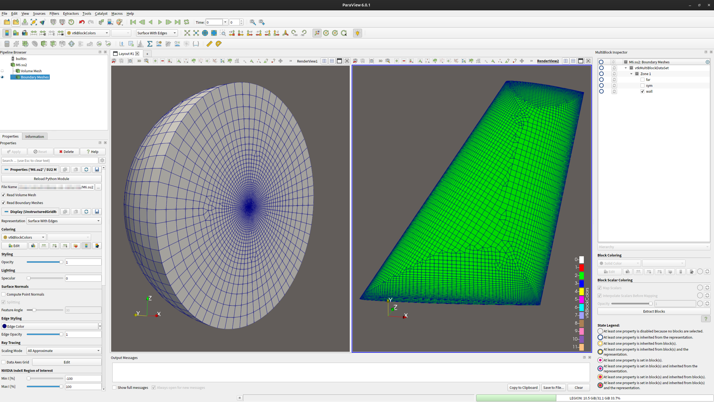
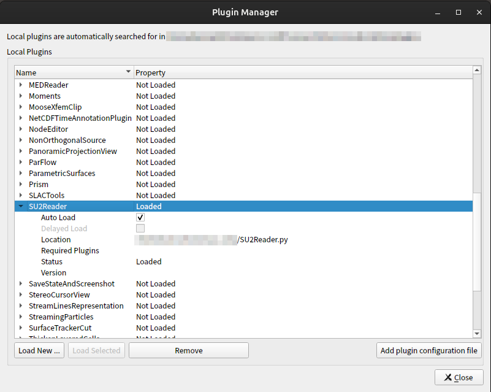
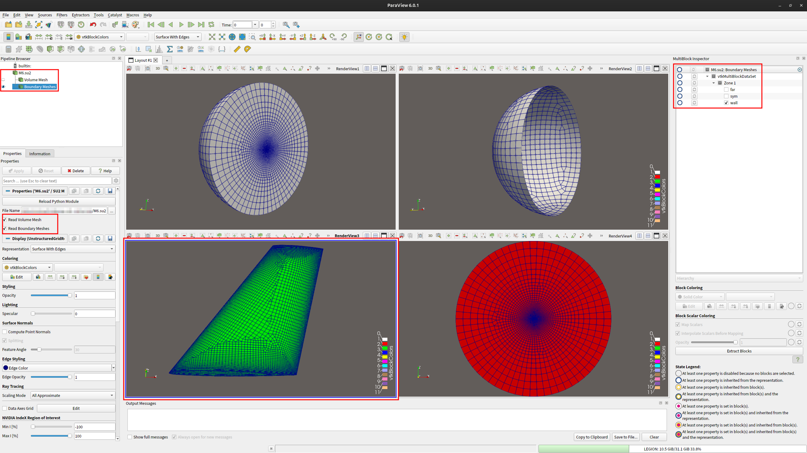
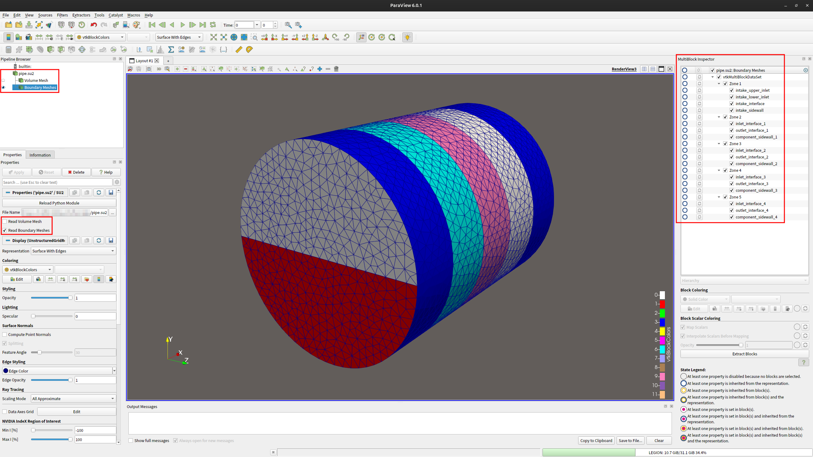

# SU2 Mesh Reader for ParaView

A ParaView Python plugin for reading `.su2` meshes and displaying the interior
mesh and boundary markers as separate outputs.

Both 2D and 3D meshes are supported, including triangles, quadrilaterals,
tetrahedra, hexahedra, prisms, and pyramids. Boundary markers retain their SU2
names and can be displayed individually. Multi-zone files using `NZONE` and
`IZONE` are supported.

## Installation

Download [SU2Reader.py](https://raw.githubusercontent.com/WangShekun/paraview-su2-reader/main/SU2Reader.py)
and save it locally. In ParaView:

1. Open Tools > Manage Plugins.
2. Click Load New and select `SU2Reader.py`.
3. Check that SU2Reader is marked Loaded.
4. Enable Auto Load if you want the plugin to load at startup.

No compilation is needed. Use a ParaView installation with Python support.
To update the plugin, replace the file and restart ParaView.

Tested with ParaView 6.0.1 on Ubuntu 24.04 LTS and ParaView 5.13.3 on Windows 11.

## Usage

### Load a mesh

Open a `.su2` file through File > Open. If ParaView asks for a reader, choose
SU2 Mesh Reader.

In Properties, choose what to read using Read Volume Mesh and Read Boundary
Meshes, then click Apply. Both are enabled by default and apply to single-zone
and multi-zone files alike. To load only the boundaries, uncheck Read Volume Mesh.

Expand the reader in the Pipeline Browser to access its outputs:

| Output | Contents |
| --- | --- |
| Volume Mesh | Interior mesh blocks, one per zone |
| Boundary Meshes | Boundary markers grouped by zone |

Use the eye icons beside the outputs to switch their visibility. Select Surface
With Edges to show the mesh edges.

### Show boundary markers

1. Open View > MultiBlock Inspector.
2. Select Boundary Meshes in the Pipeline Browser and click its eye icon to show it.
3. Expand a zone in the block tree to see its marker names.
4. Use the checkboxes to show or hide individual markers.

### Multi-zone meshes

Each zone is listed separately in the MultiBlock Inspector. Select Volume Mesh
to control zone visibility, or Boundary Meshes to select markers within each
zone. Single-zone meshes appear under Zone 1.

The example below shows the boundary meshes of a five-zone pipe.

## License

[MIT](LICENSE)
